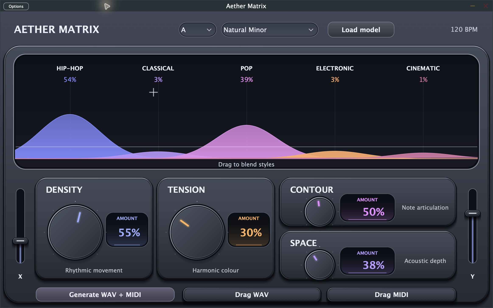

# Aether Matrix

Local piano generation with editable MIDI and matching recorded-piano audio, alongside the original XY synthesis instrument. AU / VST3 / standalone, C++20 and JUCE.

[Website](https://PelayoGarrido.github.io/Aether-Matrix/) · [Releases](https://github.com/PelayoGarrido/Aether-Matrix/releases) · [Builds](https://github.com/PelayoGarrido/Aether-Matrix/actions) · [Contribute](CONTRIBUTING.md)

**v1.0.0-rc.1 is a release candidate, not a stable production release.** The native workflow is implemented and tested, but musical consistency, commercial model/output rights, clean-machine installation and prolonged DAW sessions remain unqualified. Read the [readiness report](docs/v1/READINESS.md) before choosing it for a project. No optional weights or sample bank are redistributed.



## Piano Studio

- Real pretrained transformers compose a piano score and predict velocity, articulation, timing and pedal locally. There is no cloud inference or Python ML runtime inside the app.
- Choose fixed tempo, key, length and variation. Key conditions the model; it does not prohibit chromatic notes or guarantee a useful composition.
- A native recorded-piano renderer produces 48 kHz / 24-bit stereo WAV and high-resolution MIDI from the same expressive performance. Audio is sampled piano, **not a neural waveform model**.
- Audition a completed take, drag WAV/MIDI into your DAW, edit its notes or velocities there, then import that MIDI to render it again. The import path preserves the edited performance rather than applying AI expression a second time.
- Cancel bounded background jobs; a failed or cancelled new job keeps the previous successful take available. Each completed job retains performance, integrity metadata and instrument credits in the user's Music/AetherMatrix_Exports folder.

Studio auditions its completed audio on its own clock. It does not follow DAW transport or play incoming live MIDI through the recorded piano. Takes/resources are not restored automatically with DAW projects; retain the exported files with your session. Long notes or gaps beyond the expression model's vocabulary fail explicitly. Some otherwise valid controls/seeds can therefore be rejected. These are current product limits, not compatibility promises.

### First use and optional assets

The application never downloads assets automatically. Matrix Synth works without them. For the **research Piano Studio** path, review [model provenance](docs/v1/MODEL_REVIEW.md) and acquire the pinned assets explicitly from a source checkout:

```sh
python3 scripts/check_storage.py --reserve-gib 5
python3 tools/midi/download_candidate.py
python3 tools/performance/download.py
python3 tools/piano/download.py .build-downloads/salamander-v3
```

These standard-library downloaders verify revisions, sizes and SHA256. Python 3.11+ is needed for acquisition only; PyTorch is not needed to run Studio. Assets total approximately **1.96 GB decimal**: composition 938 MB, expression 272 MB, instrument 748 MB. Keep at least 3 GiB physically free after downloads and leave room for builds/exports. Interrupted or unverified files are preserved for inspection.

Open the standalone or plugin, select **Piano Studio → Local piano resources**, and choose the checkout's `.build-downloads` folder. It must contain `midi-tv2o-medium/`, `pianist-transformer/` and `salamander-v3/`. Choose controls, generate and audition. For an edited MIDI take use **Render edited MIDI**. See [supported MIDI input](docs/v1/PIANO_STUDIO.md).

The optional model cards use Apache labels, while some listed training corpora have non-commercial terms. **Commercial suitability is unresolved.** The open-source code licence does not grant blanket permission for model outputs. Salamander's CC-BY-3.0 attribution accompanies each recorded-piano render. No training corpus is downloaded or concealed.

## Matrix Synth

The metallic editor retains the XY interpolation between five synthesis styles, live MIDI, host-tempo sequencing, root/scale/density/tension/articulation/reverb controls, and background four-bar WAV plus multi-track MIDI export. Existing parameter identifiers remain unchanged.

The bundled `rave_decoder.onnx` is a deterministic sine-basis reference decoder, not a trained RAVE model. Reference inference is available on Apple Silicon and Windows x64 at 48 kHz; other rates/Intel use hybrid synthesis. Offline Matrix exports use that hybrid synth. The reference loader accepts only the exact bundled model bytes; arbitrary ONNX execution in the DAW has been removed.

No account, runtime network request or telemetry is required. Helpers are separate bounded processes with restricted environment and verified inputs; **they are not an OS sandbox**. [Architecture](docs/ARCHITECTURE.md).

## Install

Download an installer from a published release or the artifacts of a successful CI run. Never install artifacts from an untrusted fork. Close the DAW before installation, then reopen it and rescan plugins. Administrator permission is required.

### macOS 14 or later

1. Open `Aether_Matrix_macOS.pkg` and follow the installer.
2. If blocked, open **System Settings → Privacy & Security → Open Anyway**, then reopen the installer. [Apple's instructions](https://support.apple.com/102445).

Installs the standalone app in `/Applications/` and a universal AU and VST3 into `/Library/Audio/Plug-Ins/Components/` and `/Library/Audio/Plug-Ins/VST3/`. The shared reference model goes in `/Library/Application Support/AetherAudioLabs/AetherMatrix/`. The current ONNX runtime has an arm64 slice; Intel runs the universal hybrid synth.

The package is unsigned and the plugins are ad-hoc signed, **not notarized**. The installer removes quarantine only from the two installed bundles, verifies their ad-hoc signatures and requests an AudioComponentRegistrar restart. This does not guarantee Gatekeeper or host acceptance on every Mac. Do not disable Gatekeeper globally. If Logic rejects a component, check it in Plug-in Manager and report the host/macOS versions.

### Windows 10/11 x64

1. Open `Aether_Matrix_Windows_Setup.exe` and follow the installer.
2. If SmartScreen offers an override for this trusted build, use **More info → Run anyway**. Managed devices may prohibit overrides; contact the administrator.

Installs VST3 into `C:\Program Files\Common Files\VST3\Aether Matrix.vst3`, the reference model into `C:\ProgramData\AetherAudioLabs\AetherMatrix`, and the required redistributable runtime files beside the plugin binary. The installer is not Authenticode signed. Use Windows Settings to uninstall.

## Build from source

Requires CMake 3.24+, Python 3 and a C++20 compiler. On macOS use full Xcode; on Windows use Visual Studio 2022 or newer with Desktop development with C++, plus Inno Setup 6 for packaging. JUCE and ONNX SDKs are fetched at configure time with pinned revisions/checksums; no package-manager install is needed. Allow at least 3 GiB of free space before starting.

```sh
git clone https://github.com/PelayoGarrido/Aether-Matrix.git
cd Aether-Matrix
./scripts/build.sh '-DCMAKE_OSX_ARCHITECTURES=arm64;x86_64'
./installers/macos/build_pkg.sh build 1.0.0
```

Windows, in a developer PowerShell:

```powershell
python scripts/check_storage.py --reserve-gib 3
cmake -S . -B build -A x64 -DAETHER_BUILD_GENERATION_TOOLS=ON
cmake --build build --config Release --parallel 2
ctest --test-dir build -C Release --output-on-failure
& "${env:ProgramFiles(x86)}\Inno Setup 6\ISCC.exe" "/DBuildDir=$pwd\build" installers/windows/installer.iss
```

Before packaging Windows locally, copy the Microsoft x64 CRT redistributable DLLs from Visual Studio's `VC/Redist/MSVC/<version>/x64/Microsoft.VC*.CRT/` into the VST3 bundle's `Contents/x86_64-win/` directory and its `Helpers/` subdirectory, as CI does. Do not copy DLLs from arbitrary system folders or download sites.

Outputs are in `build/Aether_Matrix_artefacts/Release/`; installers are in `build/installers/`. Builds never install directly into your DAW plugin folders. Use `-DAETHER_ENABLE_ONNX=OFF -DAETHER_BUILD_GENERATION_TOOLS=OFF` for synthesis-only development, or `-DAETHER_ORT_ROOT=/path/to/extracted/sdk` to reuse an existing 1.31.0 SDK. See [models](docs/MODELS.md), [architecture](docs/ARCHITECTURE.md) and [dependency review](docs/DEPENDENCIES.md).

The website has no frontend dependencies:

```sh
cd web
pnpm dev
pnpm check
```

## License

[AGPL-3.0-or-later](LICENSE), matching JUCE 8's open-source licensing route. See [third-party notices](THIRD_PARTY_NOTICES.md). A commercial, closed-source derivative requires a separate review of JUCE and other licensing terms; this repository does not grant a commercial JUCE licence.

Website photography and video retain their respective third-party media licences; see [media credits](web/ASSETS.md).
